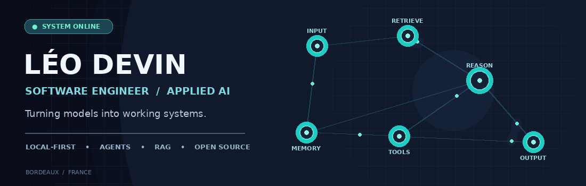
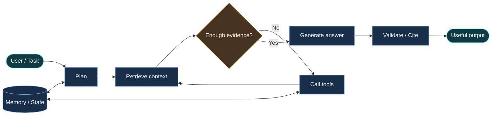

<div align="center">



<br/>

[](https://www.linkedin.com/in/leo-devin)
[](mailto:leodevin24@gmail.com)
[](https://www.openstreetmap.org/search?query=Bordeaux)

**`BUILDING SYSTEMS THAT THINK, SEARCH, AND ACT.`**

</div>

## `> whoami`

I'm **Léo**, a software engineer and **EPITA graduate (2025)** working at the intersection of **software engineering, AI integration and data**.

My favorite engineering problems happen where a model becomes a real product: orchestrating tools, building reliable retrieval pipelines, running inference locally and making complex systems understandable.

```yaml
focus:
  - Agentic systems and tool orchestration
  - Retrieval-augmented generation and document intelligence
  - Local AI, inference and GPU-conscious engineering
  - Full-stack applications and developer tooling
engineering_values: [practical, reproducible, privacy-conscious]
currently_exploring: [LangGraph, multimodal RAG, local LLMs, developer agents]
```

## `> agent.run()`

The way I like to build AI systems:



> **Less AI theater, more engineering.** Evidence, controlled tool use, observable execution, and systems that can actually be deployed.

## `> featured_work --select`

<table>
<tr>
<td width="50%" valign="top">

### 🧠 Agentic document intelligence
**Private / professional work**

Document ingestion, OCR and layout-aware processing, semantic retrieval, and graph-based orchestration for grounded question answering.

`Python` `LangGraph` `RAG` `Weaviate` `FastAPI`

</td>
<td width="50%" valign="top">

### 🖥️ Local AI playground
**Personal experiments**

Exploring quantized models, local inference, vision-language models and OpenAI-compatible endpoints with GPU-aware constraints.

`llama.cpp` `Ollama` `vLLM` `GGUF` `Docker`

</td>
</tr>
<tr>
<td valign="top">

### 🩻 [Human Body Explorer](https://github.com/Heldeee/projet-raug)
**Interactive 3D medical visualization**

Exploring human anatomy through an interactive 3D scene and web-based controls.

`React` `Three.js` `WebXR`

[View project ↗](https://github.com/Heldeee/projet-raug) · [VR exploration ↗](https://github.com/Heldeee/projet-raug-xr)

</td>
<td valign="top">

### 📈 [Python for Big Data](https://github.com/Heldeee/projet-pybd)
**Financial data exploration**

Processing and visualizing market data through an interactive analytics application.

`Python` `Dash` `Plotly` `Docker`

[View project ↗](https://github.com/Heldeee/projet-pybd)

</td>
</tr>
</table>

<details>
<summary><b>+ More projects, experiments and things I've built</b></summary>

<br/>

| Project | What it is | Stack |
| :--- | :--- | :--- |
| [Medical Cabinet](https://github.com/Heldeee/inta_td) | Patient-management web application | React, Node.js, databases, Docker |
| [Piñte](https://github.com/Heldeee/Pinte) | Desktop drawing application built in C | C |
| [OCR Sudoku Solver](https://github.com/DraGonKill25/OCR) | Recognize and solve Sudoku grids from images | C, OCR |
| [Erased](https://github.com/Heldeee/Erased) | Metroidvania-style game | Unity, C# |
| **Tiketo** | Lightweight self-hosted Kanban tool *(personal project)* | FastAPI, SQLite, Docker |
| **Transit arrival automation** | Bus arrival lookup using transit API data and iOS Shortcuts *(experiment)* | JSON, SIRI, iOS Shortcuts |
| **Procedural 3D exploration** | Experimenting with procedural spaces and game logic *(prototype)* | Godot, GDScript |

</details>

## `> toolchain --grouped`

| Domain | Tools I work with |
| :--- | :--- |
| **AI & orchestration** | Python, LangChain, LangGraph, PyTorch, TensorFlow, Ollama, vLLM, llama.cpp |
| **Backend & data** | FastAPI, Java, Quarkus, PostgreSQL, SQLite, Weaviate, pandas, NumPy |
| **Web & interfaces** | TypeScript, JavaScript, React, Vue, Vite, HTML/CSS |
| **Systems & other** | Docker, Linux, Git, Bash, C, C++, C#, Unity, Godot |

## `> engineering_mindset`

```text
01  Start with a real problem.
02  Keep the architecture understandable.
03  Observe what the system actually does.
04  Measure, iterate, and document.
05  Prefer a useful system over an impressive demo.
```

<div align="center">

---

**Interested in AI engineering, local-first software, or building useful tools?**

[**Connect on LinkedIn**](https://www.linkedin.com/in/leo-devin) · [**Send an email**](mailto:leodevin24@gmail.com) · [**Explore my repositories**](https://github.com/Heldeee?tab=repositories)

<sub>Designed as an agentic system, built as a GitHub README. No tracking scripts, external animation services or generated activity stats.</sub>

</div>
